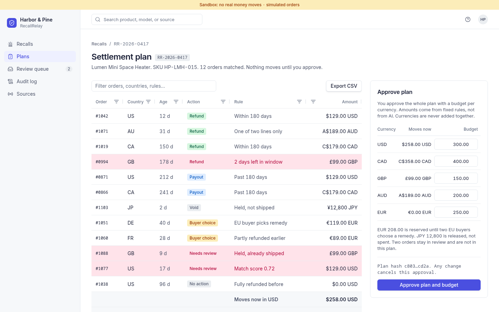
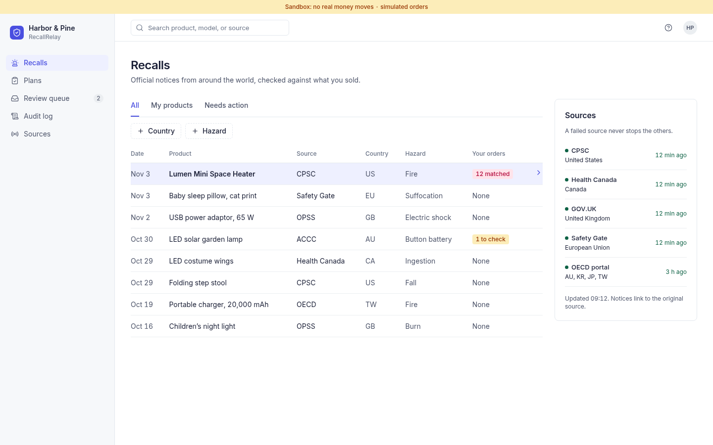
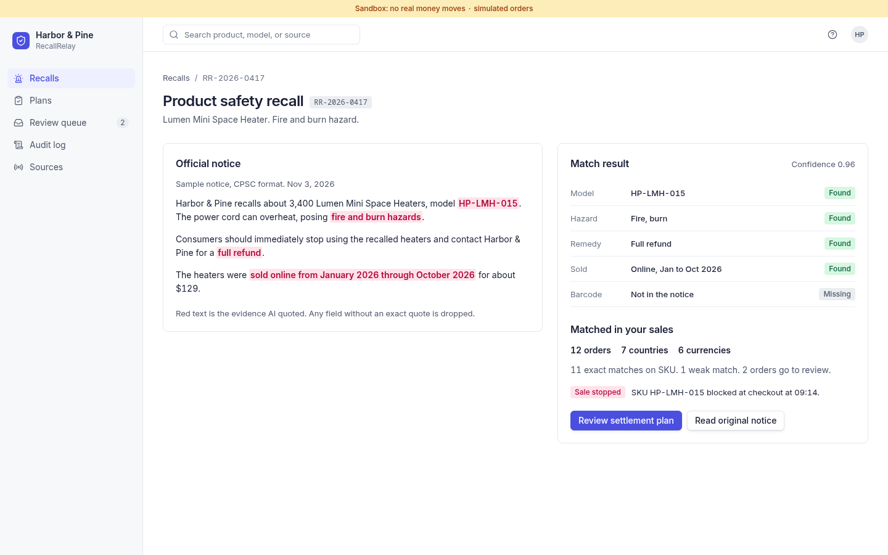
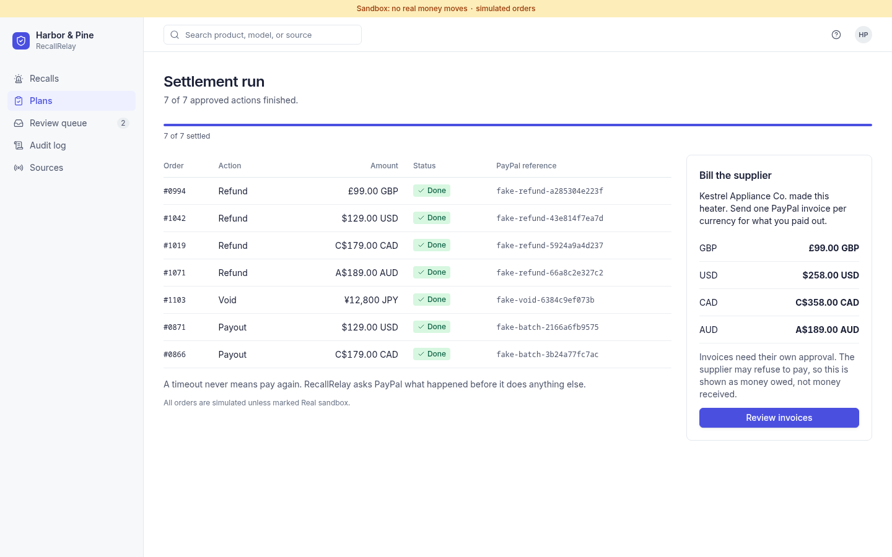
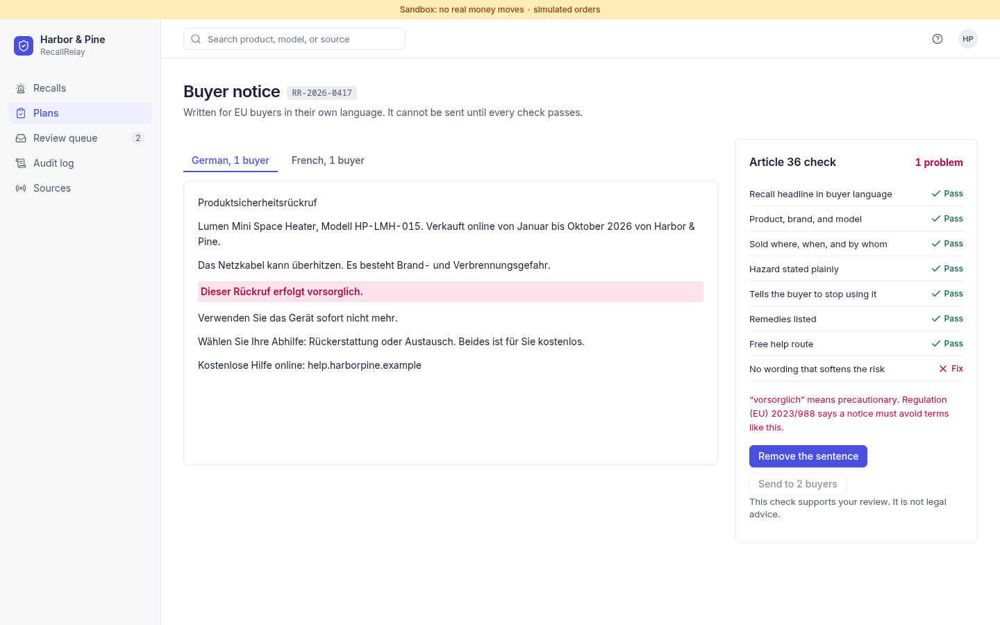
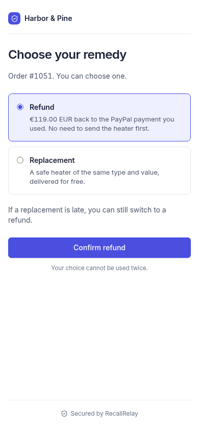
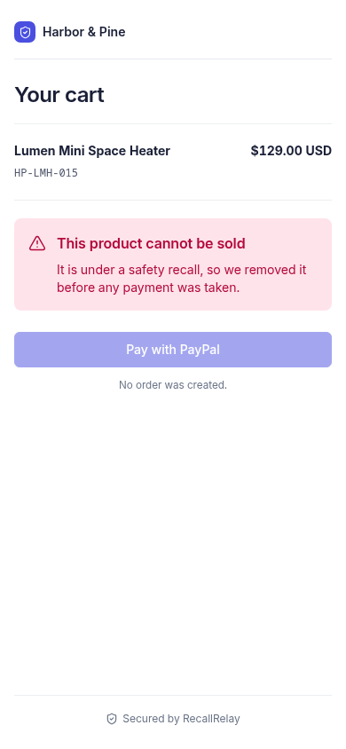

<h1 align="center">RecallRelay</h1>

<p align="center">
  When a product gets recalled, find the orders, stop the sale and settle every buyer through PayPal.
</p>

<p align="center">
  <a href="https://recallrelay.onrender.com"></a>
  <a href="https://youtu.be/sJziUsnfG3g"></a>
  <a href="https://devpost.com/software/recallrelay-kig6ex"></a>
  <a href="LICENSE"></a>
  <a href="https://github.com/AdolfoLayme/recallrelay/actions/workflows/ci.yml"></a>
</p>

<p align="center">
  
  
  
  
  
  
  
  
  
</p>



RecallRelay helps a PayPal merchant respond to a product recall. It connects an official notice to the affected orders, blocks new sales and prepares a settlement plan. A person approves the exact plan and a budget for each currency before any refund, authorization void or payout is sent. AI extracts product facts and drafts buyer notices. Plain code matches orders, picks the action and computes every amount.

## Demo

[](https://youtu.be/sJziUsnfG3g)

The narration is an AI voice. We're Spanish speakers and our English isn't good enough yet to present this ourselves.

**Try it:** https://recallrelay.onrender.com. It's a free Render service, kept awake by a scheduled ping, so it should open right away. It runs against the PayPal sandbox with simulated orders, labeled in the app. No real money moves.

## Screenshots

| Recall feed | Evidence from the notice |
|---|---|
|  |  |

| Settlement run | Buyer notice check |
|---|---|
|  |  |

| Buyer picks a remedy | Checkout blocked |
|---|---|
|  |  |

## Judge walkthrough: under three minutes

1. Open the demo and select **Start the demo**. Open the Lumen Mini Space Heater recall. Read the official notice and select **Stop sale**.
2. Select **Review settlement plan**. Inspect the 12 fictional orders, the plan hash, and the separate currency budgets. Approve the plan and budgets.
3. Open **Refund window** and move the urgent order to the front. Open **Settlement run** and execute the approved plan. Inspect PayPal references, the review queue, and the supplier invoice approval. The simulated run settles seven actions: refunds, payouts, and an authorization void.
4. Open the buyer notice. Remove the flagged risk-softening sentence to pass the checker. Visit the store to see checkout blocked for the recalled product. The buyer remedy link also demonstrates a signed choice and settlement.

The fake demo's money totals are USD 258, CAD 358, GBP 99, and AUD 189 moved; EUR 208 reserved for buyer choice; and a JPY 12,800 authorization released. These are fictional sandbox-style examples, not customer transactions.

## Real PayPal sandbox purchase

The walkthrough above needs no account. To try a real sandbox checkout on the hosted demo, use this PayPal sandbox buyer. It only holds test money.

- **Email:** `sb-m43h3c53769378@personal.example.com`
- **Password:** `Nl_1zu_D`

1. Open the demo and select **Start the demo**.
2. Go to [/store](https://recallrelay.onrender.com/store) **before** stopping the sale. After **Stop sale** the store blocks this product on purpose.
3. Select the PayPal button, log in with the buyer above and pay.
4. Follow the walkthrough. The order joins the plan marked **Real sandbox**, and the settlement run refunds it through PayPal.

## Run locally

Requires Node 26 and pnpm 12. In a clean checkout:

```bash
pnpm install --frozen-lockfile --ignore-scripts
pnpm typecheck
pnpm test
pnpm evals
pnpm demo
pnpm start
```

Open `http://localhost:3000`. No credentials are needed; `PAYPAL_MODE=fake` is the default. `pnpm test:e2e` runs the browser journey in an isolated headless profile. If your checkout path is long, copy it to a short path before running the browser test because the browser's socket path has a length limit.

## PayPal and AI

| Capability | Use in RecallRelay |
|---|---|
| Orders API and JavaScript checkout SDK | Create and capture a sandbox checkout order; check the recall blocklist before order creation. |
| Transaction Search | Import merchant transactions when item details are available; incomplete records enter human review. |
| Payments API | Refund captures and void authorizations. |
| Payouts API | Pay an eligible buyer when a capture can no longer be refunded; confirm the payout item outcome. |
| Invoicing API | Create and send a supplier reimbursement invoice only after a separate approval bound to the plan hash and settled amount. |
| Webhook signature verification | Verify PayPal events, deduplicate them, and reconcile the corresponding action against PayPal before recording success. |

The optional OpenAI-compatible provider extracts product identifiers with verbatim evidence from a notice and drafts buyer text. A deterministic fake provider supports the keyless demo. Invalid or unsupported extraction goes to review. The AI cannot approve a plan, set a budget, choose a payment action, or compute an amount.

## Architecture and safety

The Node/TypeScript server exposes a Hono JSON API and serves a React dashboard. The settlement plan is an AG Grid (Community) table: sortable and filterable columns, a quick filter, rows flagged for attention, per-currency totals pinned at the bottom (currencies are never added together) and a CSV export for the audit trail. SQLite stores private demo sessions, orders, plans, approvals, an outbox, buyer choices, and an immutable audit log. The policy and money modules use integer minor units, with no currency conversion. An outbox row is reserved before a PayPal call and carries a stable idempotency key; uncertain outcomes stay `UNKNOWN` until a PayPal read confirms them. If a refund times out without returning its PayPal ID, it stays open for manual review because a capture's aggregate refunded amount cannot identify that refund. Signed buyer links expire after 30 days. Demo sessions expire after two hours and cap money sends and AI calls. PayPal's live host is refused; sandbox credentials stay on the server.

## Known limits

The automated test suite uses fake PayPal and fake AI. The hosted demo runs in PayPal sandbox mode with simulated orders. A real sandbox purchase in `/store` needs the sandbox buyer above and is outside the offline browser suite. The last purchase and refund on the hosted demo ran on Nov 6, 2026, with sandbox capture `3WH21341F37901043` and refund `4TE10306R2180473E`. PayPal Transaction Search item detail availability varies; it returned item codes for this sandbox account after the app was granted access. Some recall matches require human review. The fake notice writer is only partly localized for arbitrary products. This prototype gives no legal advice and does not claim compliance.

MIT licensed; see [LICENSE](LICENSE).
